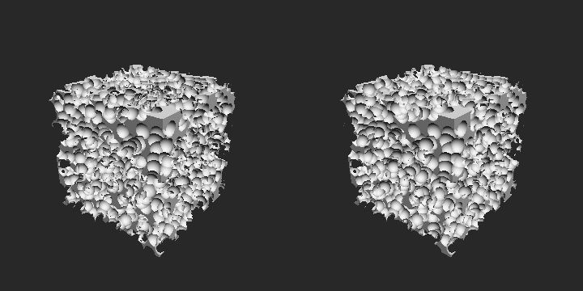

# Install

`sudo apt install libsdl2-dev libglm-dev libgl-dev`

# Build

Configurer et compiler le pipeline Marching Cubes :

```bash
cmake --preset marching-cube
cmake --build --preset marching-cube
```

L'executable est genere dans `build/build-marching-cube/marching-cube`.

Configurer et compiler le pipeline Sphere Tracing :

```bash
cmake --preset sphere-tracing
cmake --build --preset sphere-tracing
```

L'executable est genere dans `build/build-sphere-tracing/sphere-tracing`.

Configurer et compiler le benchmark d'erosion (toujours en Release) :

```bash
cmake --preset erosion-benchmark
cmake --build --preset erosion-benchmark
cd build/build-erosion-benchmark
./erosion-benchmark   # ~1 min
```

Les executables doivent etre lances depuis leur dossier de build (shaders charges en chemin relatif `assets/...`).

`source/ray_marching.cpp` contient un `main` et est exclu de `COMMON_SOURCES` dans le `CMakeLists.txt`.

# Erosion (vieillissement d'objets)

Objectif : simuler le vieillissement d'un objet SDF en projetant des spheres qui creusent localement sa surface, puis comparer une erosion incrémentale et une erosion par paquets.

## Fichiers

| Fichier | Contenu |
|---|---|
| `include/SI/SDFs.hpp`, `source/SI/SDF.cpp` | `NodeSDF::Intersect` : intersection rayon / SDF par sphere tracing |
| `include/SI/erosion.hpp`, `source/SI/erosion.cpp` | algorithme d'erosion (aucun code de mesure ou d'affichage) |
| `source/erosion_benchmark.cpp` | mesures de temps |

## Intersection : `bool NodeSDF::Intersect(const Ray& ray, double& t, double tMax = 100, double eps = 1e-4, int maxSteps = 256) const`

Sphere tracing sur l'arbre C++ (le sphere tracing de `sphere_tracing.cpp` est cote GLSL). On part de `t = 0` et on avance de `d = Value(ray(t))` jusqu'a `d < eps` (impact, `ray(t)` est sur la surface) ou `t > tMax` (rate). La direction du rayon doit etre normalisee. Defini dans `NodeSDF`, donc disponible pour toutes les primitives et tous les operateurs.

## Erosion

- `RandomDirection` : direction uniforme sur la sphere unite (tirage par rejet dans le cube).
- `RandomRay(center, radius, rng)` : origine aleatoire sur la sphere englobante de l'objet, direction vers son centre.
- `MakeUnionTree(nodes, begin, end)` : arbre d'union equilibre (profondeur log2(n)) d'une liste de noeuds.
- `ErodeIncremental(scene, nbImpacts, impactRadius, center, radius, seed)` : chaque impact est soustrait immediatement, le rayon suivant voit donc les crateres precedents. Arbre produit : `Sub(Sub(Sub(objet, s0), s1), s2)...`
- `ErodeBatch(scene, nbImpacts, batchSize, impactRadius, center, radius, seed)` : les `batchSize` rayons d'un paquet sont lances sur la meme scene, leurs crateres sont reunis par `MakeUnionTree` puis soustraits en une fois. Arbre produit : `Sub(Sub(objet, Union(paquet0)), Union(paquet1))...`. Les rayons d'un meme paquet ne voient pas les crateres les uns des autres.

Les deux methodes tirent les memes rayons pour une meme `seed`. Les noeuds sont des `std::unique_ptr<NodeSDF>` (comme le reste du projet) : stocker les noeuds par valeur casserait le polymorphisme de `Value` (slicing).

## Visualiser les deux érosions

Le viewer `marching-cube` (`source/marching_cube.cpp`) affiche la configuration où les deux méthodes diffèrent le plus : 2000 impacts, incrémental à gauche, paquets de 500 à droite (même graine, impacts aux mêmes endroits relatifs). La polygonisation des deux objets prend quelques secondes en Release, beaucoup plus en Debug :

```bash
cmake --preset marching-cube -DCMAKE_BUILD_TYPE=Release
cmake --build --preset marching-cube
cd build/build-marching-cube && ./marching-cube
```

## Protocole de mesure

- Objet : boîte de demi-côtés 0.5, cratères de rayon 0.05, même graine (42) pour toutes les méthodes : les rayons tirés sont les mêmes.
- n = 100 à 4000 impacts, paquets de k = 5 à 500.
- Pour chaque configuration (médiane de 5 mesures) :
  - **construction** : temps de `ErodeIncremental` / `ErodeBatch` ;
  - **`Value`** : temps moyen d'un appel sur l'arbre final.
- La précision est comparée visuellement (figure `figures/erosion_rendu.png`).

## Résultats

Construction (ms) / `Value` (µs) :

| n | incrémental | k = 5 | k = 10 | k = 25 | k = 50 | k = 100 | k = 500 |
|---|---|---|---|---|---|---|---|
| 100 | 0.27 / 0.86 | 0.14 / 0.41 | 0.13 / 0.37 | 0.11 / 0.37 | 0.09 / 0.38 | | |
| 500 | 8.34 / 4.44 | 4.12 / 2.21 | 3.59 / 1.92 | 3.25 / 1.79 | 2.99 / 1.69 | 2.64 / 1.69 | |
| 1000 | 42.7 / 9.10 | 20.9 / 4.53 | 18.5 / 4.08 | 16.4 / 3.74 | 15.6 / 3.55 | 14.5 / 3.52 | 6.94 / 3.51 |
| 2000 | 223 / 18.0 | 111 / 8.86 | 99.3 / 8.17 | 89.6 / 7.44 | 85.0 / 7.17 | 81.1 / 6.98 | 54.5 / 7.06 |
| 4000 | 1618 / 34.6 | 824 / 19.2 | 754 / 17.3 | 673 / 14.9 | 608 / 14.3 | 569 / 14.0 | 356 / 14.0 |

Gain des paquets sur l'incrémental pour n = 4000 :

| k | 5 | 10 | 25 | 50 | 100 | 500 |
|---|---|---|---|---|---|---|
| construction | x2.0 | x2.1 | x2.4 | x2.7 | x2.8 | x4.5 |
| `Value` | x1.8 | x2.0 | x2.3 | x2.4 | x2.5 | x2.5 |

Comparaison visuelle, 2000 impacts, incrémental à gauche et paquets de 500 à droite :



## Analyse : incrémental vs paquets

**Incrémental : plus précis, mais plus long.** Chaque rayon est lancé sur l'objet déjà creusé par tous les impacts précédents. Un projectile qui tombe dans un cratère creuse donc plus profond : c'est le comportement attendu d'une érosion, c'est la référence de précision. Le prix est un arbre en chaîne de n soustractions `Sub(Sub(Sub(objet, s0), s1), s2)...`, très profond :
- la construction coûte cher, car le rayon i doit parcourir un arbre qui contient déjà les i cratères précédents. Le temps est multiplié par 5 à 7 quand n double : il est quadratique, et même un peu plus, car la surface creusée demande plus de pas de sphere tracing ;
- l'objet final est aussi plus lent à évaluer, environ 2 fois plus lent que par paquets à nombre de cratères égal.

**Paquets : moins précis, mais plus rapide.** Les k rayons d'un paquet sont lancés sur le même objet, puis leurs cratères sont soustraits ensemble.
- Plus rapide : les rayons d'un paquet parcourent un arbre qui ne contient pas encore les cratères du paquet. L'arbre final (chaîne de n/k soustractions d'unions équilibrées) est aussi beaucoup moins profond, donc plus rapide à évaluer. Pour n = 4000, la construction est 2 à 4.5 fois plus rapide, et `Value` 1.8 à 2.5 fois plus rapide.
- Moins précis : les rayons d'un même paquet ne voient pas les cratères les uns des autres. Deux projectiles du même paquet qui tombent au même endroit creusent à la même profondeur au lieu de s'empiler. Dans les deux cas, la surface est criblée de cratères, mais en incrémental les cratères s'empilent et l'érosion va plus profond dans l'objet. Plus k est grand, moins l'objet est érodé en profondeur.

**Choix de k.** Augmenter k rend la construction plus rapide, mais l'objet moins fidèle. Le gain sur `Value` plafonne dès k ~ 25 (x2.3 à x2.5), alors que la perte de précision continue d'augmenter avec k. Des paquets de quelques dizaines de rayons donnent l'essentiel du gain (x2.4 à x2.7 sur la construction, environ x2.3 sur l'évaluation) en limitant la perte de précision, qui augmente avec k. Les deux méthodes restent quadratiques en n : les paquets divisent le temps, ils ne changent pas la façon dont il augmente avec le nombre d'impacts.


# Deux pipelines
- sphere tracing
- marching cube

# Primitives
- Sphere (Leon)
- Box (Elyas)
- Segment (Capsule)
- Cylindre
- Plane
- Cone
- Donut (optionnel)

# Operators 
- Union (Leon)
- Intersection (Elyas)
- Soustraction
- Union Smooth
- Domain Repetition 
- Displacement
- Twist
- Bend
- Noisify

# Ideas
- aplatir arbres dans GPU
- Z buffer avec plusieurs draw call pour differents material types
- compute normal not with the derivative but with normal of each primitive combined

# Optimization
- gradient avec 4 samples au lieu de 6
- BVH
- réplications en cercle et sphere avec les coordonnées sphérique 
- replication cylindrique 
- replication le long d'une courbe ? (plein de donut)

# Rendering 
- BRDF 
- BSDF ? 
- bubble
- water
- lava
- cloud
- Antialiasing

